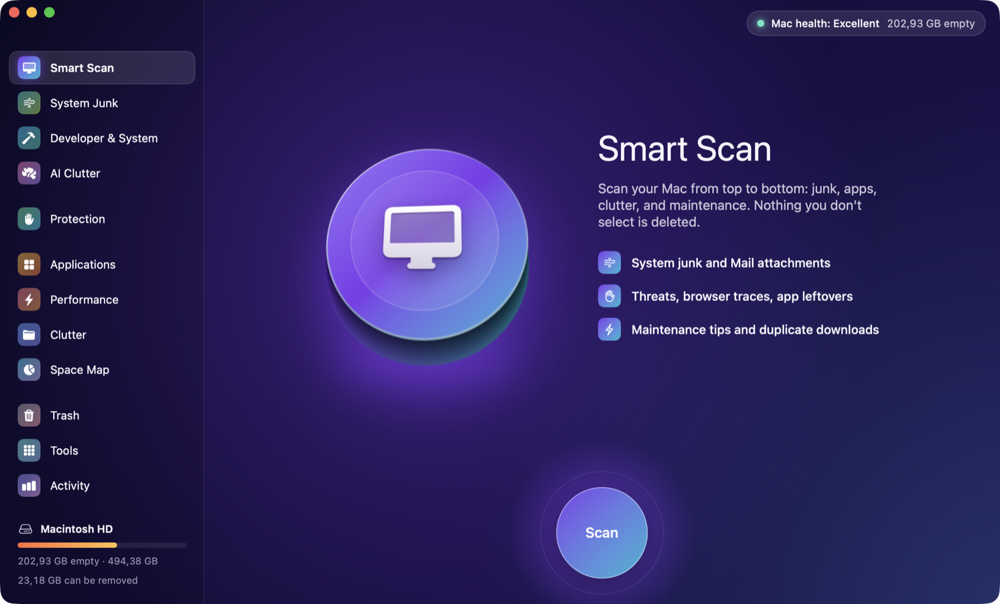
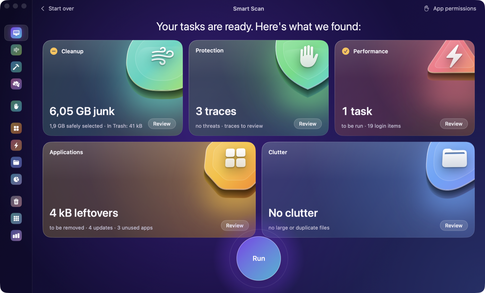
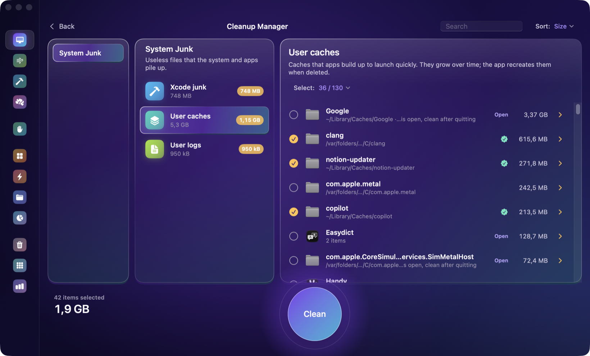

<div align="center">


# CleanMac

**A free, open-source Mac cleaner that never breaks anything.**

Clean system junk, Xcode and AI tool caches, app leftovers, duplicates and large files on macOS — everything goes to the Trash, nothing is deleted for good.

[](https://github.com/tastanmert/CleanMac/releases/latest)


[](LICENSE)

[Download](https://github.com/tastanmert/CleanMac/releases/latest) · [Features](#features) · [Safety](#how-cleanmac-keeps-your-mac-safe) · [FAQ](#faq) · [Türkçe](#türkçe)



</div>

## What is CleanMac?

CleanMac is a native macOS app, written in SwiftUI, that frees disk space and keeps your Mac tidy. It finds caches, logs, build products, leftovers of uninstalled apps, duplicate files and forgotten downloads, explains what each item is, and pre-selects only what is safe to remove. Everything it removes is moved to the Trash, so any cleanup can be undone until you empty it.

It is built for everyday users and for developers: it knows where Xcode, simulators, npm, uv, pnpm, Homebrew, Hugging Face, Ollama, LM Studio and AI coding tools keep their gigabytes.

Available in **English** and **Turkish**: CleanMac follows your macOS language, and you can switch it in Settings.

## Features

| Module | What it does |
|---|---|
| **Smart Scan** | One button checks everything in turn: system junk, threats and privacy traces, maintenance, apps and clutter. Runs only the safe, selected tasks. |
| **System Junk** | User caches (sandboxed apps included), logs, Xcode junk, broken preferences and launch agents, AI tool junk, local models, Mail attachments. |
| **Developer & System** | Simulators and runtimes, device support files, archives, package manager caches, test browsers, system logs, deleted users, iOS backups. |
| **AI Clutter** | Caches, logs and temp folders of AI apps and coding agents; unused Ollama and LM Studio models. |
| **Protection** | Unsigned or tampered apps and suspicious launch agents, browser history and cookies, recent items, app permissions, saved Wi‑Fi networks. |
| **Applications** | Uninstaller that removes an app with all its files, unused apps, leftovers of removed apps, installers, update checker. |
| **Performance** | Maintenance tasks, login and background items, an energy audit with a 0–100 score (sleep blockers, battery health, swap, power settings). |
| **Clutter** | Large and old files, duplicates, similar photos, old downloads grouped by the site they came from. |
| **Space Map** | A visual map of your disk, hidden folders included. |
| **Trash, Tools, Activity** | Empty every Trash bin, jump to any tool, see how much space you freed over time and what you chose to ignore. |

Plus a menu bar extra with disk and memory status, in-app updates, Quick Look, "ignore" lists and a full cleanup log.

<p align="center"></p>
<p align="center"></p>

## How CleanMac keeps your Mac safe

- **Trash, not delete.** Files are moved to the Trash. Tool caches (`brew`, `npm`…) are cleared with the tool's own command.
- **A guard on every path.** Right before anything is moved, `SafetyGuard` checks it against a policy for that kind of item. Keychains, Mail, iCloud Drive, Documents, Desktop and `~/.ssh` are never touched by automatic rules.
- **Review means review.** Anything that might matter (backups, models, leftovers, large files, threats) is listed but never selected for you.
- **Open apps are left alone.** Their caches are listed but not selected, and checked again at cleanup time.
- **Apple's own files stay.** `com.apple.*` items are never offered by the leftover, threat or launch-item rules.
- **No other disks.** Network shares and connected devices are never crossed into.
- **Everything is logged** in `~/Library/Logs/CleanMac/`.

## Install

1. Download `CleanMac.dmg` from the [latest release](https://github.com/tastanmert/CleanMac/releases/latest).
2. Drag CleanMac to Applications.
3. The app is not notarized yet: if macOS blocks the first launch, open **System Settings › Privacy & Security** and click **Open Anyway**.
4. Grant **Full Disk Access** when asked for a complete scan.

CleanMac checks for updates at launch and once a day (can be turned off). An update is downloaded from this repository's releases, its signature and version are verified, and the old copy is moved to the Trash.

Universal binary for Apple Silicon and Intel, macOS 15 Sequoia or later.

## Build from source

```bash
git clone https://github.com/tastanmert/CleanMac.git
cd CleanMac
swift test               # runs in under a second
swift run CleanMac       # run from source
./scripts/build-app.sh   # build and install /Applications/CleanMac.app
./scripts/make-dmg.sh    # build/CleanMac.dmg
```

Requires Xcode 16 or later. The code is split into `CleanMacCore` (rules, scanner, safety guard, cleaner; UI-free and tested) and `CleanMac` (the SwiftUI app).

## FAQ

**Is CleanMac free?**
Yes. CleanMac is free and open source under the GPL-3.0 license, with no ads, accounts or tracking.

**Is it safe to clean caches on a Mac?**
Caches are rebuilt automatically by the apps that made them. CleanMac only pre-selects caches of apps that are closed, moves them to the Trash, and lets you put anything back.

**How do I free up space taken by Xcode?**
CleanMac's System Junk module removes DerivedData and Xcode caches; the Developer & System module lists old simulators, runtimes, device support files and archives for you to choose from.

**Can it clean caches of AI tools and local models?**
Yes. AI Clutter finds caches, logs and temp folders of AI apps and coding agents, and lists Ollama and LM Studio models with their sizes.

**Does CleanMac remove leftovers of uninstalled apps?**
Yes. It finds preferences, support files and containers of apps that are no longer installed, while protecting anything that belongs to an app you still have.

**Is it an antivirus?**
No. Protection lists apps and background services that Gatekeeper would not trust (unsigned, tampered, or run from hidden folders). It does not use a malware database.

**Does it send any data?**
No. Scans run entirely on your Mac. The only network request is the update check against this repository's releases.

## Contributing

Issues and pull requests are welcome; see [CONTRIBUTING.md](CONTRIBUTING.md). Safety reports go through [SECURITY.md](SECURITY.md).

## License

CleanMac is free software: you can redistribute it and modify it under the terms of the [GNU General Public License v3.0](LICENSE). Contributions are accepted under the terms in [CONTRIBUTING.md](CONTRIBUTING.md). The CleanMac name and icon are not licensed for use by forks.

© 2026 [Mert Taştan](https://merttastan.com)

---

## Türkçe

**CleanMac, Mac için ücretsiz ve açık kaynak bir temizleyicidir; hiçbir şeyi bozmaz.**

Sistem çöpünü, Xcode ve yapay zekâ araçlarının önbelleklerini, kaldırılmış uygulamaların artıklarını, kopya ve büyük dosyaları bulur. Her öğenin ne olduğunu açıklar, yalnız güvenle silinebilecekleri seçer. Her şey Çöp'e taşınır; Çöp'ü boşaltana kadar geri alabilirsin.

**Modüller:**
- **Akıllı Tarama:** tek tuşla hepsini tarar.
- **Sistem Çöpü:** önbellekler, günlükler, Xcode çöpü, bozuk öğeler, AI çöp dosyaları, yerel modeller, Mail ekleri.
- **Geliştirici ve Sistem:** simülatörler, paket önbellekleri, sistem günlükleri, cihaz yedekleri.
- **AI Artıkları:** AI uygulamalarının ve kodlama ajanlarının önbellekleri, kullanılmayan modeller.
- **Koruma:** şüpheli uygulamalar ve servisler, tarayıcı izleri, son öğeler, uygulama izinleri, Wi‑Fi ağları.
- **Uygulamalar:** kaldırıcı, kullanılmayanlar, artıklar, kurulum dosyaları, güncellemeler.
- **Performans:** bakım görevleri, başlangıç öğeleri, enerji denetimi.
- **Dağınıklık:** büyük ve eski dosyalar, kopyalar, benzer görseller, eski indirilenler.
- **Alan Haritası, Çöp, Araçlarım, Etkinlik.**

**Kurulum:**
1. [Son sürümden](https://github.com/tastanmert/CleanMac/releases/latest) `CleanMac.dmg`'yi indir.
2. CleanMac'i Uygulamalar klasörüne sürükle.
3. İlk açılışta engellenirse Sistem Ayarları › Gizlilik ve Güvenlik › **Yine de Aç**.

macOS 15 ve üstü gerekir. Apple Silicon ve Intel desteklenir.

**Dil:** Türkçe ve İngilizce. CleanMac macOS dilini izler; Ayarlar'dan değiştirilebilir.

**Lisans:** GPL-3.0. Kod serbestçe kullanılıp geliştirilebilir. Değiştirilmiş sürümler de açık kaynak kalmak zorundadır; kapalı kaynak kopya yapılamaz. CleanMac adı ve ikonu saklıdır.
